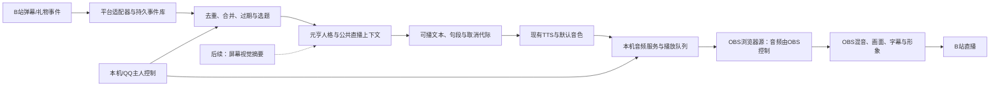

# B站无人 AI 主播：弹幕 → 元亨 → TTS → OBS

日期：2026-10-07。交付：源代码调研与开发方案，尚未部署或实测直播。

用户已确认首版平台为 B 站。硬要求：语音从 TTS 开始，不经本机扬声器，直接由 OBS 合成直播；不以麦克风、ASR、AEC 或双工输入作为前置条件。

## 1. 推荐结论

首选 **TTS → 本机音频服务 → OBS 浏览器源 → OBS 混音器 → B站**。虚拟声卡作可切换备选；无论哪种模式，都禁止失败后自动改用系统扬声器。

先完成“固定文字 → TTS → OBS 本地录制”，再接入真实弹幕。屏幕视觉是额外观察源，放在主链稳定之后；人格微调另线推进，主播先用已经通过当前验收的模型组合，不因为直播而重写元亨人格。



OBS 负责音视频合成、编码、上传；B站弹幕连接是另一条独立连接，弹幕不是 OBS 自动提供的。此图不包含“先扬声器播放再采集”的绕路。

## 2. NachoBot 核查：能借鉴什么，不能照搬什么

正确仓库是 [Big-Sh0t114/NachoBot](https://github.com/Big-Sh0t114/NachoBot)，`Sh0t` 中是数字 0。本轮固定阅读提交 `be2b003fc9215d5d9a336cb1be1fff0d92626d5b`，源码放在 `cache/external_refs/NachoBot-review-20261007/`；仅克隆与阅读，未运行脚本、安装依赖或加载其人格。

### 2.1 已核查源码及用途

以下路径均相对 NachoBot 仓库，均可在固定提交下复核。

| 文件 | 代码事实 | 对 YHLZ 的取舍 |
|---|---|---|
| `NachoBot-Bilibili-Adapter/bili_src/live/live_worker.py` | getDanmuInfo token/host 列表、WS 认证/心跳；16 字节协议头、zlib/brotli；弹幕/礼物/SC/舰长分派 | 参考平台解析与连接生命周期；增加报文长度/解压上限、隔离 reader 与业务 |
| `NachoBot-Bilibili-Adapter/adapter.py` | `handle_incoming_danmu` 构造平台消息进入核心；筛自身消息；可加入屏幕摘要 | 参考标准事件与上下文边界，不引入它整套 Core 和人物设定 |
| `bili_src/live/danmu_buffer.py` | 480 秒窗口、ID 去重、未回复池 | 参考候选池，但 8 分钟不能直接用作待播 TTL；它是内存态且无数量上限 |
| `bili_src/live/live_streamer.py` | 弹幕多时少思考、少时多轮发散，再润色和 TTS | 只参考思路。当前 adapter 的导入、创建和路由被注释，不能宣称这条控制器在运行 |
| `bili_src/audio/tts_manager.py` | 收集文本、句子分段、逐段合成；首段就绪后 apply Live2D；写字幕文件 | 参考句段与形象联动；当前“音频已入队”日志不能当“观众听到了” |
| `bili_src/audio/audio_player.py` | 优先远程 Live2D 播放，失败回退 winsound；按 WAV 时长等待 | 不照搬输出与完成判断，winsound 会使用本机音频设备；按时长等待不等于播放回执 |
| `NachoBot-Live2D-Adapter/live2d_adapter/renderer.py` | pygame.mixer 在渲染进程播放 WAV | 窗口音频可供 OBS 采集，但不自动保证扬声器静音 |
| `NachoBot-UniversalVC-Adapter/audio_output.py` | 可选虚拟声卡；找不到目标时回退默认设备 | 设备绑定可参考；该 fallback 与用户要求直接冲突，必须改为静音故障态 |

关键源码链接：

- [B站平台处理](https://github.com/Big-Sh0t114/NachoBot/blob/be2b003fc9215d5d9a336cb1be1fff0d92626d5b/NachoBot-Bilibili-Adapter/adapter.py#L945)
- [弹幕解包和消息标识](https://github.com/Big-Sh0t114/NachoBot/blob/be2b003fc9215d5d9a336cb1be1fff0d92626d5b/NachoBot-Bilibili-Adapter/bili_src/live/live_worker.py#L912)
- [音频播放器与 winsound 回退](https://github.com/Big-Sh0t114/NachoBot/blob/be2b003fc9215d5d9a336cb1be1fff0d92626d5b/NachoBot-Bilibili-Adapter/bili_src/audio/audio_player.py#L113)
- [虚拟设备失败后的默认设备回退](https://github.com/Big-Sh0t114/NachoBot/blob/be2b003fc9215d5d9a336cb1be1fff0d92626d5b/NachoBot-UniversalVC-Adapter/audio_output.py#L62)

仓库根许可证为 GPLv3。首轮做独立接口实现和工程思路参考；如实施时复制具体代码，逐文件保留来源、许可证并核对分发要求，不当成无条件可并入任意授权代码。

### 2.2 两个需要吸取的教训

1. 现参考解析器在没有稳定 message_id 时用时间戳加随机 UUID，重连后无法据此去重。YHLZ 应优先用平台原始 ID；确实缺失时用平台/房间/发送者/原时间/内容指纹做短窗口保守去重，并记 `id_quality=weak`，避免把两次真实重复发言永久合并。
2. 选择、润色、多轮发散叠加会增加首句等待。首版采用程序筛选候选 + 一次元亨生成，不默认每条弹幕两次 LLM，不默认无人时无限自说。

## 3. 当前 YHLZ 的可复用边界

- `backend/tts_provider_port.py` 已有 `TTSRequest`、`PCM_CHUNK`、`PCM_STREAM_END`、停止状态、24kHz mono s16le 契约。用这些做新输出端上游，不重新造 TTS 引擎。
- `backend/tts_qwen_provider.py` 明确写出当前 Qwen generator 需要完整文本；声明 `text_stream=False`。`SegmentedTTSProvider` 是逐句工程流式，不能宣传成原生逐 token TTS。
- 保留用户既有默认本地克隆音色；实际 provider、参考音频与 voice_id 在节点 1 记录。不能在直播接线时悄悄改成另一种系统音色。
- `backend/target_playback.py` 有显式设备与连续重采样，可作虚拟声卡候选出口；OBS browser 模式绕过物理 PlaybackPort，直接消费 PCM。
- QQ Lite 的 reader/队列、认主、持久任务与诊断设计可借鉴，直播 connector 独立生命周期、独立房间上下文；不要让 QQ 消息和弹幕共享同一条待播队列。
- 老白皮书写有 `updates/live_stream/` 和 GPT-SoVITS/winsound 直播模块，但本轮本地这两个目录 `updates/`、`plugins/` 不存在。文档说明不算可直接调用的生产模块。
- 台账 0677 的 QQ 套件通过不代表 B站接入、OBS 或 TTS 到混音器已通过；台账 0643 的 CosyVoice/vLLM 显存结论是估算，不作为本次可用性依据。

## 4. 弹幕阅读：接收全量，选择回应，不逐条积压朗读

### 4.1 首版平台连接

首版限定一个 B站直播间，配置 room_id、连接方式和机器人平台身份；短号到真实房间号的解析在连接准备阶段完成。房间号、登录状态和 OBS 版本在实施预检读取，本轮没有连接用户直播间。

优先选择可合法配置且能取得消息的接入方式：有开放平台应用/主播授权时按该协议实现；否则以 NachoBot 使用的普通直播 WS 路线作技术候选，实际鉴权与可用字段须只读实连验证。不把这条普通接口称为官方稳定开放 API，也不保证匿名连接一直能读完整弹幕。

connector 只负责鉴权、解包、心跳、重连和事件落库。收到消息后尽快返回 reader，昵称补查、LLM、TTS 均不在 reader 中等待。每房间只有一个 active connector 租约，恢复时重新取得过期 token，不能无限重试同一失效凭据。

标准事件建议：

```json
{
  "event_id": "bili:<room_id>:<platform_message_id>",
  "platform": "bilibili",
  "room_id": "configured_room",
  "kind": "chat",
  "sender_id": "platform_uid",
  "display_name": "观众",
  "text": "你刚才在看什么？",
  "source_ts": 0,
  "received_at": 0,
  "reply_to": null,
  "id_quality": "native",
  "priority": "normal"
}
```

源时间用于新鲜度，接收时间用于链路计时；程序使用单调时钟计算本机耗时。显示名与弹幕内容作为数据，不拼成系统命令。B站 UID 与 QQ `2258374446` 不是同一种身份：不把同名或同数字观众自动当主人。首版管理仍走本机控制台/已认主 QQ，B站弹幕全部按公共聊天处理。

### 4.2 选题与播报

默认是“读懂后回复”，不是把每条观众原文直接 TTS。必要时用短引述：“有人问刚才在看什么……”；连播用户名、完整原文和完整答案会延长排队，因此不设为强制格式。可在本机设置明确的测试朗读模式，但不作为默认无人直播策略。

首版建议参数（待测，不是性能承诺）：

| 项目 | 初值 | 作用 |
|---|---:|---|
| 入站热队列 | 256 事件 | 可持久落库，但不无界驻内存 |
| 待选候选池 | 100 条 / 普通消息 30 秒 TTL | 丢过期候选，不追着旧弹幕念 |
| 上下文窗口 | 当前房间最近 50 条摘要 + 最近 8 条原文 | 复用 QQ 设计思想，不复用私人内容 |
| 聚合窗口 | 0.5–1 秒 | 把同一问题的刷屏归成一题 |
| 每轮候选 | 最多 3 条相关消息 | 一次生成回答一个主题，可标记多个来源 |
| LLM 并发 | 1 | 防止多个答案争抢说话权 |
| 待播音频 | 最多 12 秒 + 一个当前片段 | 超出时停止预生成，回到候选合并 |
| 普通回复 | 通常 1–2 句，30–60 汉字 | 给新弹幕留下插入机会 |
| 冷场 | 20–40 秒无新话题且无待播才触发 | 主动说一段后等回应，不无限发散 |

优先级：主人控制（立即）> 已确认需回应的重点事件/问题 > 普通相关弹幕 > 冷场话题。礼物/SC/舰长可聚合感谢，不能连续刷礼物就永远饿死普通问题。重点事件最多连续两个，然后检查普通候选；paid 事件也不能获得工具执行权。

新弹幕可取消尚未播出的冷场稿；已经开口的普通句子尽量在句末结束，只有主人 stop 或故障才立即清空。屏幕视觉和后台记忆回顾不能抢占前台播报。

### 4.3 记录“收到”和“实际播出”

状态链：`received → eligible → selected → generating → tts_ready → scheduled → sink_started → sink_ended`；并存 `expired / coalesced / cancelled / failed / unknown`。

同一 speech 可以关联多个弹幕 event_id。选中或生成完成不能直接 `mark_replied`；至少 audio sink 确认开始消费才记“已开始回答”，消费完成记“本地播出完成”。缺回执记 unknown，不自动重播，避免一个问题重复回答三次。

OBS 本地播放完成也不等于观众已收到，另记录 OBS 推流状态与可取得的丢帧/拥塞指标。平台 CDN 和播放器缓存的真实观众延迟必须通过观看端测量。

## 5. 音频直入 OBS：首选浏览器源，备选虚拟线

### 5.1 首选路线：音频在 OBS 内部产生输出

```text
TTS 24kHz mono PCM
  → 本地 HTTP/WS 音频服务
  → OBS 内嵌浏览器里的 WebAudio 音频队列
  → “通过 OBS 控制音频 / Control audio via OBS”
  → OBS mixer → 直播/录制音轨
```

这里的 WebSocket 是应用自有的音频服务，不是 obs-websocket 控制协议。OBS 的 obs-websocket 只用于查询配置、场景、音量、监听类型、录制/推流状态，不接受任意 PCM 音频注入。

官方依据：

- [OBS Browser Source](https://obsproject.com/kb/browser-source)：OBS 以 CEF 浏览器源加载网页，可控制源生命周期。
- [obs-browser 官方音频重路由选项](https://github.com/obsproject/obs-browser/blob/master/data/locale/en-US.ini)：`RerouteAudio="Control audio via OBS"`。
- [obs-browser 实现](https://github.com/obsproject/obs-browser/blob/master/obs-browser-source.cpp)：`reroute_audio` 进入 BrowserClient 音频路由。
- [obs-websocket 协议](https://github.com/obsproject/obs-websocket/blob/master/docs/generated/protocol.md)：`GetInputAudioMonitorType`、`SetInputAudioMonitorType`、`GetStreamStatus` 等控制接口。

这些确认功能设计存在，不等于本机 OBS 版本已经验收。部署前必须检查实际 OBS 版本、浏览器源组件和此选项的行为。

设置要点：

1. 创建专用浏览器音频源 `YuanhengVoice`，URL 为本机服务（如配置的 loopback 端口）。不使用普通浏览器 tab 播放。
2. 开启“通过 OBS 控制音频”，在高级音频属性选“监听关闭”；该源不静音，绑定实际推流音轨和单独录制音轨。
3. 不启用 Windows 设备侦听，不重复用 Desktop Audio 采集本音源。用户无需听到 TTS 的本机声。
4. 服务收到经控制端确认的 OBS 路由设置与单消费者 lease 后才派发音频；设置缺失时不自动播。页面默认静音/AudioContext 不运行，只有准备就绪握手后 resume。
5. 本机音频页不提供任意访客 autoplay；额外打开预览页面只显示状态，不能抢音频 lease。音频只发给配置的 OBS 客户端实例。
6. route watchdog 监测监听/重路由配置变化并停发、静音。无法保证“检查之后人为改配置”完全无竞态，因此真机验收要测错误配置和改动恢复；不能在未验证时宣称绝无物理输出可能。
7. 跨场景引用同一个音频源，不复制多个播放器。为避免切场景截断，音频源的“不显示时关闭”和“激活时刷新”按稳定播放需要配置；暂停/结束由控制器明确执行。

浏览器方案首版分两步：先每句 WAV 经本地 URL 提供，做连续队列和开始/结束回执；再在验证有效后加入 PCM chunk + WebAudio/AudioWorklet，减少整句等待。两种模式都在 OBS 内播放，不用 winsound、pygame 或系统默认声卡。

页面生命周期异常、AudioContext suspended、源卸载或 WS 断开时回报失效，暂停 TTS 生产、清理旧 generation 的缓冲。重连不自动从句首补播已经开始但状态未知的句子，下一句使用新 generation。

### 5.2 PCM 协议与同步

控制头记录 `session_id, turn_id, speech_id, segment_id, epoch, seq, sample_rate, channels, format, samples`；音频二进制另发，不把每个小包编码成 JSON base64。

服务不能改 TTS 采样率标签冒充 48kHz。选择一个有状态重采样点：服务侧连续 24→48kHz，或者 AudioContext 按真实格式重采样；只做一次。配置、边界和尾帧需有测试。

推荐起点：20ms PCM 帧，网络聚合 40–80ms，初始抖动缓冲 120–200ms，客户端硬上限 2 秒；“待播总时长上限 12 秒”属于服务层，不与客户端音频缓冲混为一个数。

sink 用 AudioContext 样本时间调度，不为每个包独立 setTimeout。维护排队、开始消费、已消费样本数、结束/取消回执；回执代表浏览器音频消费证据，OBS 混音/录制证据另外记录。

字幕在对应片段实际开始消费后显示；口型可从同一 PCM 能量/音素信息驱动，不开麦监听音量。Live2D/形象窗口关闭自身播放，只负责画面，否则会出现第二份声音。暂停清字幕、闭口型并清旧 PCM。

### 5.3 备选路线：专用虚拟音频设备

```text
TTS PCM → 指定虚拟播放端（例 CABLE Input）
        → 配对虚拟录音端（例 CABLE Output）
        → OBS Audio Input Capture → mixer
```

端点名称以安装的驱动为准，不自动改系统默认输出。OBS 监听关闭，Windows “侦听此设备”关闭。找不到绑定端点就停止，严禁 NachoBot 那样的 default output fallback。

浏览器源和虚拟线是二选一 active route，不能同时输出一段 TTS。备选方案仍需驱动/设备重枚举测试；本轮未安装驱动。

只做应用音频捕获不够：OBS 能抓进程音频，不代表那个进程没有同时把声音送到扬声器。所以不把“捕获 Live2D/pygame 窗口音频”列为本需求的默认完成路径。

## 6. 流式、延迟与 8GB 显存

首版延迟拆成：

`弹幕传输 + 选题等待 + LLM首个可播句 + TTS首PCM + sink缓冲 + OBS编码 + B站分发/播放器缓存`。

本机首声统计从接到弹幕到 OBS 录制首个有效语音样本；不能拿 TTS 首 PCM 时间代替。观众端延迟单独测，无法由本地优化彻底消除。

先测 30 条短弹幕并分别报告 p50/p95。建议工程目标：入站解析/入队 p95≤100ms、选题合并≤1秒、首 PCM 到 OBS 本地声音 p95≤300ms；模型首句/首PCM耗时先建基线，再判断是否能做到本机总首声≤4秒。此处均为待验证目标。

Qwen 当前完整文本输入，可用已存在的 SegmentedTTSProvider 在语义句边界合成。首段尝试 12–24 汉字、逗句号优先、无标点最长等待 500ms；后续 24–48 字，均需对短句韵律和尾字丢失评测后调整。它是工程分段，不是端到端语音模型，也不需要训练才能接 OBS。

8GB 上先固定当前本地 LLM/TTS 组合测峰值，OBS 渲染、硬件编码、形象纹理和视觉组件也计入。NVENC 并非完全零显存成本。不直接加 CosyVoice/vLLM 或新视觉模型。若内存或计算无法共存，明确采取模型降配/受控串行/已配置远程后端之一，不能频繁卸载加载却继续宣称低延迟。

训练期间资源锁禁止直播 worker 抢 GPU，QQ 传输仍可常开；后台画面识别最先降级。测清合成实时率：如果持续 RTF≥1，音频队列会缺粮，缓存不能补救长期速度不足，必须降低合成成本或减少讲话量。

## 7. 无人值守调度与故障规则

节目状态：`stopped → preparing → ready → live → pausing/recovering → live → ending`。未取得完整健康证据不能自报 live；OBS 已在推流但弹幕断线时如实标记 degraded。

| 故障 | 行为 |
|---|---|
| 弹幕 WS 掉线 | 独立退避重连；暂停引用新弹幕，不虚构观众发言；不无脑重启 OBS |
| LLM 不可用 | 不再排新回答；已确认可播段可播完；限量缓存过渡语后安静，不循环同一句 |
| TTS 失败 | 取消本 speech 未播段、清口型；保留字幕可选，不改用扬声器 |
| OBS 源掉线/音轨关闭 | 停发音频、取消过期段、静音恢复；不积压恢复后长篇补播 |
| 程序重启 | 恢复事件和任务状态；已播/unknown 不从头复播；过期弹幕只留统计 |
| 主人 stop | 撤销租约、增 epoch、停生产和播放，优先于所有礼物或普通回复 |
| 房间未开播/结束 | 根据状态停止无人话题循环；本地测试模式须显式区分 |

AI 可自主选择话题、回复弹幕和表达；直播聊天只拿公共记忆和受限工具，不获得文件分享、开发、git 或主人私聊内容。默认首版不自动发文字弹幕、不自动互动其他直播间；语音回复已经由 OBS 发布。后续若要同步文字回复，应单独接平台发送回执和幂等记录。

无人运行不等于无人知道异常：本地状态页记录故障和待处理原因，可通过已有主人控制通道查询。公开开播由明确的房间和启动动作控制，本轮只设计和本地验证，不擅自开始推流。

## 8. 六段实施与三个主验收节点

| 段 | 交付内容 | 证据 |
|---|---|---|
| L0 预检与固定版本 | OBS版本/音轨/源能力；TTS音色/格式；房间连接方式；模型路由；CPU/GPU基线 | manifest.json、capabilities.json，凭据仅指纹 |
| L1 TTS直入OBS | 本机音频服务+OBS页面；整句队列→PCM升级；停止/回执/禁止默认播放 | 固定10段音频录制、route_probe.json、取消与断线测试 |
| L2 B站弹幕 | 只读连接、标准事件、解包上限、去重、重连、fake回放 | event_samples脱敏、connector_matrix.json |
| L3 主播编排 | 选题/TTL/聚合、元亨生成、分段TTS、有限待播、公共scope | 30题答复追踪、burst_replay.json、delay_report.json |
| L4 字幕与形象 | 音频消费时钟带动字幕与口型；场景切换和不重复音源；冷场有限策略 | sync_report.json、场景切换录像 |
| L5 无人长稳 | 故障注入、OBS重启、断网、模型失败、资源锁与恢复 | 30min故障/2h本地录制/后续24h观察，不混报 |

**验收 A：TTS 输出真实进入 OBS，本机不发声。** L0/L1 完成。固定声音可在 OBS 独立音轨录制；本机物理输出观测无该声音；route 异常不 fallback；暂停无尾巴、无双声、采样率/音调正确。耳听只作辅助，实际录制和输出端点证据是主要依据。

**验收 B：一条真实弹幕形成一个可追溯的完整回答。** L2/L3 完成。接收、选题、模型、合成、开始/结束回执对应同一 trace；模拟 100 条/秒 60 秒的回放不会无限堆积，过期/合并各有计数；认主不串平台；实时流量另测，不把 fake 接入当真机。

**验收 C：无人运行不会自嗨积压或坏掉后乱播。** L4/L5 完成。字幕/口型跟实际消费同步、场景切换不重复音频、至少 30 分钟故障注入和 2 小时本地录制；24小时运行是后续观察，不提前宣称完成。上述完成后，带平台推流的观众端延迟与公开环境再单独签收。

建议新模块作为独立运行的直播 service，例如 `tools/live_service.py` 配置装配，下辖 `backend/live/{events,connector_bilibili,event_store,scheduler,conversation,tts_bridge,audio_sink,obs_control}.py`，页面放 `web/live_output/`，测试 `tests/live/`。名称是实施接口建议，不表示文件已创建。服务按需运行，不能启动时调用全栈 ensure_stack；QQ Lite无需改成直播总控。

## 9. 交付顺序与尚待实测事项

最先开发 L1：用已有 TTS 的固定文字，拿到一段“OBS 内有声、扬声器没声”的录像。这一步无需 B站登录、人格微调或视觉模型。随后 L2 做 B站只读弹幕，再 L3 接元亨，再补形象和无人长稳。

首版已明确 B站，尚待实施阶段核实：房间号与身份/鉴权、OBS具体版本与路由选项、现有TTS实跑音色与首PCM耗时、Gemma与TTS/OBS的显存共存、形象来源。本轮没有实际模型调用、公开发消息或开播，未把外部 README 的能力宣称转作本机验收结果。

前一份双方向路线把虚拟声卡列首选；本轮核实 OBS 浏览器源音频重路由后，更新为“浏览器源优先、虚拟线备选”，两者均须 L1 真机验证再定生产路线。

源码核查指纹清单：`artifacts/nachobot_live_review_20261007/source_manifest.json`。
