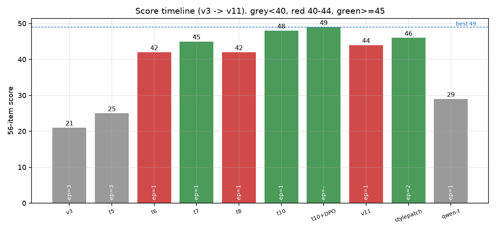
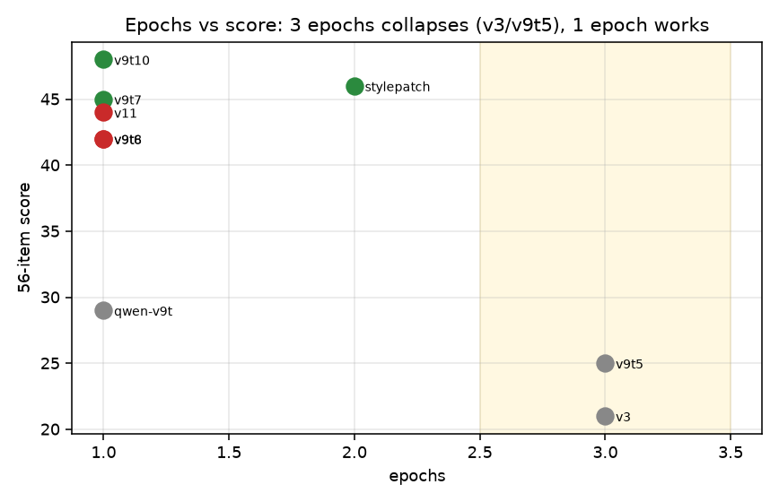
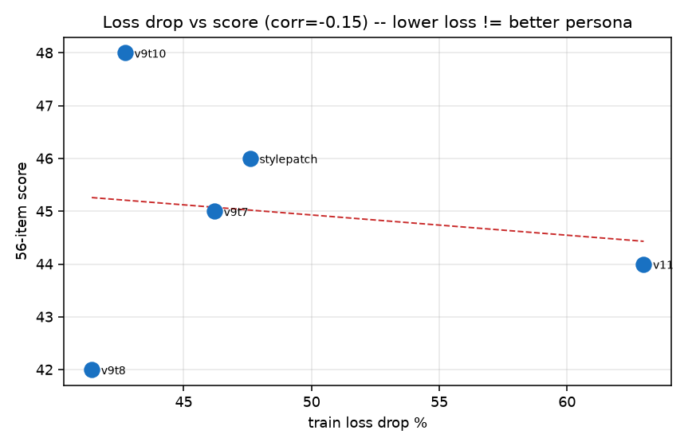
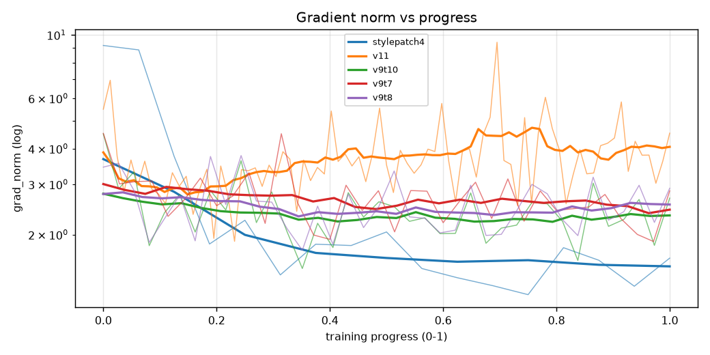

# 训练全时间线比对：学习率 / loss / 梯度 / 公式（v3 → v11）

> 2026-11-14 · 利贞
> 数据来源全部是本机真实文件：`dist/retrain_pkg_*/config/*.json`（16 份）、
> `models/lora/*/train_log.csv`（5 份逐 step）、`dist/finetune_bundle_v{3,4,6}.zip` 内的配置、
> `dist/v8_adapter/adapter_config.json`、`cache/eval56*.json`、`docs/报告/*`。
> 图在 `docs/研究/训练曲线/`。

---

## 一、总表（按时间顺序）

| 版本 | 基座 | 方法 | lr | epochs | 有效batch | seq | 数据条数 | 56 题 | loss 降幅 |
|---|---|---|---|---|---|---|---|---|---|
| v3 | gemma-E4B | LoRA | 2e-4 | **3** | 16 (4×4) | 2048 | 少量 | **21** | — |
| v9t5 | gemma-E4B | LoRA | 2e-4 | **3** | 8 (1×8) | 1536 | 6116 | **25** | — |
| **v9t6** | gemma-E4B | LoRA | 2e-4 | **1** | 8 (4×2) | 1536 | 6155 | **42** | — |
| v9t7 | gemma-E4B | LoRA | 2e-4 | 1 | 8 | 1536 | 5659 | **45** | 46.2% |
| v9t8 | gemma-E4B | LoRA | 2e-4 | 1 | 8 | 1536 | 5931 | **42** | 41.4% |
| **v9t10** | gemma-E4B | LoRA | 2e-4 | 1 | 8 | 1536 | 5931 | **48** | 42.7% |
| **v9t10-dpo2** | gemma-E4B | **DPO** | — | — | — | — | 风格对 | **49** | — |
| v11 | gemma-E4B | LoRA | **1.5e-4** | 1 | 8 (8×1) | 1536 | **13189** | **44** | **63.0%** |
| stylepatch4 | dpo2+ | SFT 补丁 | 3e-5 | 2 | 8 | 640 | **318** | **46** | 47.6% |
| qwen-v9t | qwen3-4B | **全参** | 2e-5 | 1 | 16 | 2048 | — | 29（另测 35） | — |
| v8 | gemma-QAT | LoRA | — | — | — | — | — | 人格回归 17–19/**20** | — |

> v8 那行是**另一套题**（20 题人格回归），不能和 56 题横比，只作时间线记录。



---

## 二、五个结论（都有数字支撑）

### ① ⭐ 最大的单点缺陷：**3 个 epoch**

| 版本 | epochs | 数据 | lr | 有效 batch | 56 题 |
|---|---|---|---|---|---|
| v9t5 | **3** | 6116 | 2e-4 | 8 | **25** |
| v9t6 | **1** | 6155 | 2e-4 | **8** | **42** |

**只改了 epoch（3→1）**，数据几乎一样（+39 条）、lr 一样、**有效 batch 一样（都是 8）**，
分数 **+17**。

v3 也是 3 epoch（2048 序列、4×4 batch）→ **21 分**。两个 3-epoch 的实验分别是 21 和 25，
**全部落在谷底**。



> **规程建议**：SFT 默认 **1 epoch**；要跑 3 epoch 必须先有 1 epoch 的对照，否则默认就是自残。
> 这条以前是"经验"，现在是**两个独立实验的一致证据**。

### ② 数据多 2.2 倍，分数掉 4 分

v9t10（5931 条，lr 2e-4）**48** → v11（13189 条，lr 1.5e-4）**44**。

⚠️ **但这次实验同时改了两样**（数据量 ×2.2 且 lr 2e-4→1.5e-4），
**不能干净归因**——这是我们的实验设计缺陷，见 §三.1。

### ③ loss 降得越多，分数反而略低（相关系数 **-0.15**）

| 版本 | loss 降幅 | 56 题 |
|---|---|---|
| v9t10 | 42.7% | **48** |
| v9t8 | 41.4% | 42 |
| v9t7 | 46.2% | 45 |
| v11 | **63.0%** | 44 |
| stylepatch4 | 47.6% | 46 |



**v11 降得最狠（63%），分数却最低之一。** 这说明低于某点之后，loss 继续掉 =
**在背风格模板**，不是在学"元亨"。**以后 loss 只能用来确认"训练在动"，不能当优化目标。**

### ④ 有效 batch 从头到尾都是 8 —— 之前怀疑 batch 的假设可以排除

| 版本 | batch×accum | 有效 |
|---|---|---|
| v9t5 | 1×8 | 8 |
| v9t6–v9t10 | 4×2 | 8 |
| v11 | 8×1 | 8 |

形状变了、**有效值没变**。所以 v9t5→v9t6 的 +17 分**不可能是 batch 的功劳**。

### ⑤ 梯度确实变"躁"了，但没炸

| 版本 | grad_norm 均值 | p95 | 最大 |
|---|---|---|---|
| v9t8 | 2.55 | 3.58 | 3.78 |
| v9t10 | 2.43 | 3.36 | 4.50 |
| v9t7 | 2.70 | 3.60 | 4.52 |
| v11 | **3.73** | **5.74** | **9.43** |
| stylepatch4 | 2.64 | 8.93 | 9.19 |

v11 的梯度整体抬高了 ~50%（数据更杂、权重差异更大），**p95 5.74 / max 9.43**——
没有爆炸（无 NaN/无 100+），但确实更抖。这与它分数下降、破闸（r07）方向一致。



---

## 三、公式与实现（从代码抠出来的，不是回忆）

### 3.1 损失
- **标准 causal LM 交叉熵**（无 label smoothing），标签按 `mask_prompt` 把 prompt 段置 `-100`
  （只对 assistant 输出算 loss）。
- **样本权重**：不是直接乘在 loss 上，而是**按 weight 做重采样**（`finetune_train.py` 里
  `rng.choices(weights=w/Σw, k=n)`，总数不变）——因为 2026-11-08 审计发现 `weight` 字段
  **以前根本没进训练**（`_slim()` 把它丢了）。

### 3.2 学习率调度
```
warmup_steps = max(1, int(warmup_ratio × steps_per_epoch × epochs))
lr(t) = cosine 衰减（v9t11 起显式指定 lr_scheduler_type="cosine"）
```
- ⚠️ **v9t5–v9t10 的配置里 `lr_scheduler_type` / `optim` 字段是 `None`**，
  也就是**吃的是 Trainer 默认**，我们当时并没有显式控制调度——这是配置层面的不确定项，
  v9t11 才写死 `cosine` + `paged_adamw_8bit`。
- 日志里 lr 从峰值降到 ~1e-8（cosine 到底），符合公式。

### 3.3 有效批与步数
```
eff_batch = batch_size × grad_accum          # 全程 = 8
steps_per_epoch = ceil(n_train / eff_batch)
total_steps = steps_per_epoch × epochs
```
例：v11 `ceil(13189/8)=1649`，1 epoch = 1649 步，实测日志正是 1649。

### 3.4 梯度裁剪
`max_grad_norm = 1.0`（Trainer 默认）——从 grad_norm 峰值只有 9.4 看，裁剪**没被频繁触发**，
即梯度本身不狂野。

### 3.5 DPO（v9t10-dpo2）
`loss = -log σ(β·[log π(y_w|x) − log π_ref(y_w|x)] − β·[log π(y_l|x) − log π_ref(y_l|x)])`
β 取 TRL 默认；这是目前**唯一超过 48 的手段**（48 → 49，且群聊 25→27）。

---

## 四、找出来的问题（按严重度）

| # | 问题 | 证据 | 怎么改 |
|---|---|---|---|
| **P1** | **默认 3 epoch 会毁模型** | 两个 3-epoch 实验 = 21、25；改 1 epoch +17 | 规程写死 **1 epoch 起**；要加 epoch 必须先有对照 |
| **P2** | **实验一次改多个变量** | v11 同时改数据量 ×2.2、lr、batch 形状 → 无法归因 | **一次只改一个**，其余锁定 |
| **P3** | **拿 loss 当成功指标** | loss 降幅与分数相关 **-0.15**，v11 降 63% 只得 44 | loss 只用于确认"在训练"；结论只看 56+28 实测 |
| **P4** | 早期版本 lr 调度未显式 | v9t5–v9t10 配置里 `lr_scheduler_type=None` | 全新配置一律显式写 cosine + optim |
| **P5** | 全量微调（qwen 期 29–35）远低于 gemma LoRA | eval56 记录 | 除非有明确理由，**不回到全参** |
| **P6** | 小样本 SFT 补丁会拆掉 DPO 平衡 | stylepatch4：在 dpo2 上补 318 条 → 46（-3） | 补丁类改动必须**小步 + 回归**，且优先用 DPO 而非 SFT |
| **P7** | 没有"同配置重跑"的稳定性证据 | 我们只验证过**评测**两次一致，没验证过**训练**两次一致 | 冒烟测试里加一次重复训练，看分数方差 |

---

## 五、下一步（等卡）

1. **冒烟测试**（60 条过拟合）——验"通路健康"，判据见《Gemma4风格微调_诊断与训练_可执行_20261114.md》
2. **单变量对照**：
   - A：v9t10 原配置重跑一次 → 看 48 是否可复现（**P7**）
   - B：v9t10 数据 ×2.2 但 lr 锁 2e-4 → 干净地验"数据多是否有害"（**P2** 的正确做法）
3. **KL 锚定 dpo2**（λ 0.03）+ 1 epoch，看能否在保住 49 的同时吸收新风格
4. 全部以 **56+28 双跑一致**为验收，不看 loss

---

## 六、附：原始数据文件

| 文件 | 内容 |
|---|---|
| `训练曲线/hyperparams.csv` | 16 份配置的全部超参 |
| `训练曲线/run_stats.csv` | 5 条曲线的起点/终点/降幅/lr/梯度统计 |
| `训练曲线/timeline_raw.json` | 老 bundle 配置 + v8 adapter 参数 + 人格回归分数 |
| `训练曲线/*.png` | 5 张图（loss-step / loss-progress / lr / grad_norm / 时间线 / epoch 关系 / loss-score 关系） |
